# Corne Corner

My [keymap](https://czak.github.io/corne/) and [practice ground](https://czak.github.io/corne/tutor/) for a PandaKB W-Corne v4.1 (46 keys, Vial firmware).

The keyboard itself is the source of truth: `kb.py` reads it live and writes changes straight to it, the same as editing in Vial.

- `docs/`: the rendered layers (SVGs, shown below) and an HTML page of them.
- `docs/tutor/`: a typing tutor. Paste a text and type it; the keys to hold and tap for each character light up on the
  keymap. `docs/tutor/keymap.js` is generated by `render`; the other files are edited by hand.
- `backups/` (not in git): the keyboard's state before each change made with `kb.py`, as TOML.

```sh
python3 kb.py render                              # keyboard -> docs/ (incl. docs/tutor/keymap.js) and the pictures below
python3 kb.py set 0 "right top 1" F14             # change one key: layer, position (half, top|home|bottom|thumb, n-th from the left), keycode
python3 kb.py td 0 0 RPRN --term 200              # tap dance TD(0): tap 0, hold )
python3 kb.py combo 1 A "LALT_T(S)" --output LGUI # combo: A+S = GUI
python3 kb.py setting TAPPING_TERM 180            # QMK setting
python3 kb.py dump [FILE]                         # keyboard -> TOML, e.g. to edit several things at once ...
python3 kb.py push FILE                           # ... and write it back (also restores a backup)
python3 kb.py diff FILE                           # keyboard vs a TOML file
```

Every change first backs the keyboard up to `backups/`, then reads it back to verify. Layers are referred to by number,
as on the keyboard: `MO(3)`, `LT(1,BSPACE)`.

The keyboard is reached over raw HID through its 2.4G dongle. The `KEYCODES` table in `corne/keycodes.py` lists every keycode name you can use (generated from [vial-gui](https://github.com/vial-kb/vial-gui)).

## App shortcuts on layer 2

Layer 2 (left hand) sends chords that mean the same thing in most apps, so one key does the "same" job everywhere. Where
an app has no such action the chord is bound by hand. The Kitty lines go in `~/.config/kitty/kitty.conf`.

| Key | Sends | Chrome / Firefox | Kitty |
| --- | --- | --- | --- |
| E / R | Ctrl+PgUp / Ctrl+PgDn | previous / next tab | `map ctrl+page_up previous_tab`, `map ctrl+page_down next_tab` |
| T | Alt+T | | `map alt+t new_tab_with_cwd` |
| D | Alt+D | | `map alt+d launch --location=split --cwd=current` |
| F | Ctrl+F | find in page | `map ctrl+f show_scrollback` (scrollback in `less`; search with `/`) |
| G | Ctrl+G | find next | not bound |
| Z | F11 | fullscreen | `map f11 toggle_layout stack` (zoom the current pane) |
| B | Ctrl+Shift+B | toggle bookmarks bar | `map ctrl+shift+b set_tab_title` (rename tab) |

On layer 3 (window manager, Super held) the same Z key sends F, so Super+F is fullscreen in sway.

<!-- keymap:start -->



### Layer 0



### Layer 1



### Layer 2



### Layer 3



### Layer 4



### Layer 5



### Layer 6


### Layer 7


<!-- keymap:end -->
