# Corne Corner

My [keymap](https://czak.github.io/corne/) and [practice ground](https://czak.github.io/corne/tutor/) for a PandaKB W-Corne v4.1 (46 keys, Vial firmware), based on [Miryoku](https://github.com/manna-harbour/miryoku) QWERTY.

- `keymap.toml`: the keymap and QMK settings. This is the source of truth.
- `docs/`: the rendered layers (SVGs, shown below) and an HTML page of them.
- `docs/tutor/`: a typing tutor. Paste a text and type it; the keys to hold and tap for each character light up on the
  keymap. `docs/tutor/keymap.js` is generated by `render`; the other files are edited by hand.

```sh
python3 kb.py diff     # keyboard vs keymap.toml
python3 kb.py push     # write the changes to the keyboard (backs up to backups/, then verifies)
python3 kb.py render   # regenerate docs/ (including docs/tutor/keymap.js) and the pictures below
python3 kb.py pull     # keyboard -> keymap.toml
```

The keyboard is reached over raw HID through its 2.4G dongle. The `KEYCODES` table in `corne/keycodes.py` lists every keycode name you can use (generated from [vial-gui](https://github.com/vial-kb/vial-gui)).

<!-- keymap:start -->


### BASE


### NUM


### SYM


### FUN



### NAV



### WM



### L6



### L7



<!-- keymap:end -->
