# Corne keymap

My keymap for a PandaKB W-Corne v4.1 (46 keys, Vial firmware), based on Miryoku QWERTY.

- `keymap.toml`: the keymap and QMK settings. This is the source of truth.
- `docs/`: the rendered layers (SVGs, shown below), plus `keymap.html` for viewing them offline.

```sh
python3 kb.py diff     # keyboard vs keymap.toml
python3 kb.py push     # write the changes to the keyboard (backs up to backups/, then verifies)
python3 kb.py render   # regenerate docs/ and the pictures below
python3 kb.py pull     # keyboard -> keymap.toml
```

The keyboard is reached over raw HID through its 2.4G dongle. The `KEYCODES` table in `corne/keycodes.py` lists every keycode name you can use (generated from [vial-gui](https://github.com/vial-kb/vial-gui)).

<!-- keymap:start -->


### BASE



### BUTTON


### NAV


### MOUSE



### MEDIA



### NUM



### SYM


### FUN


<!-- keymap:end -->
